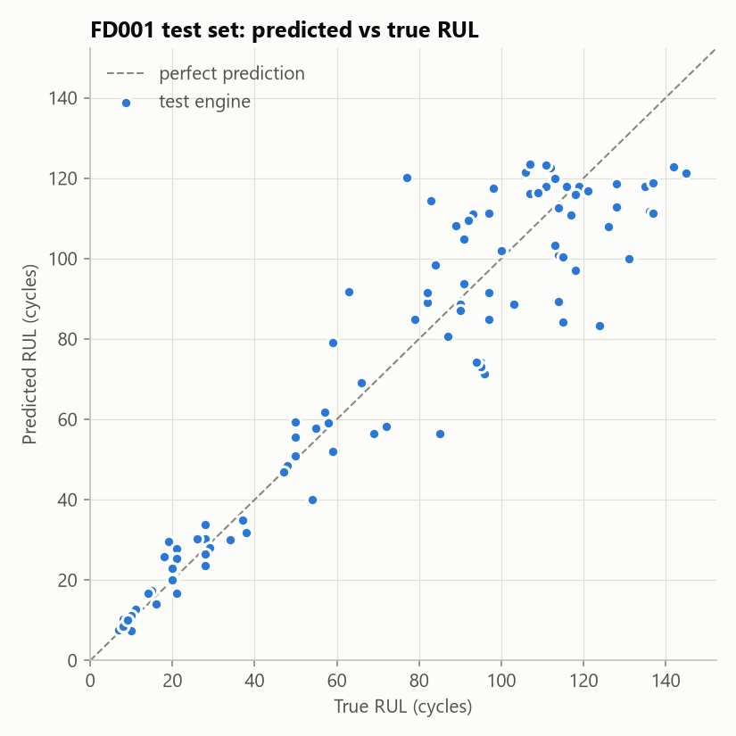
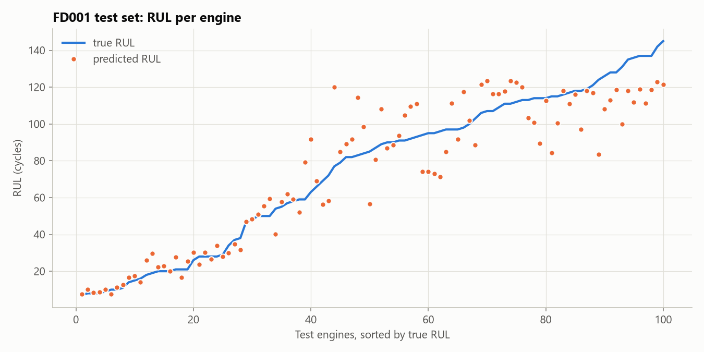
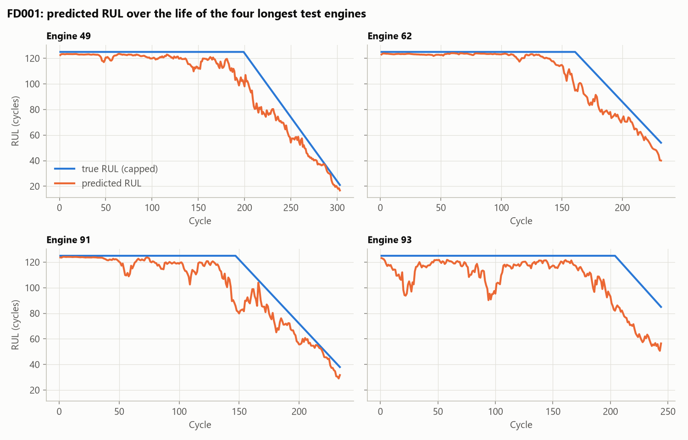
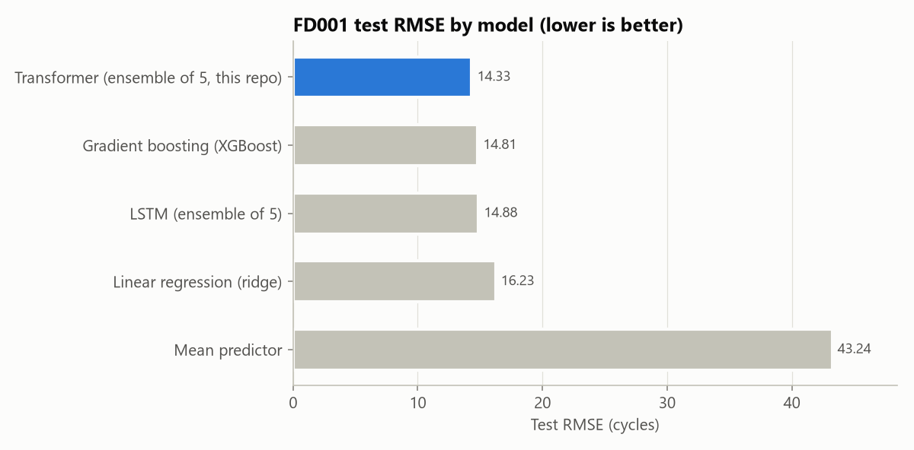
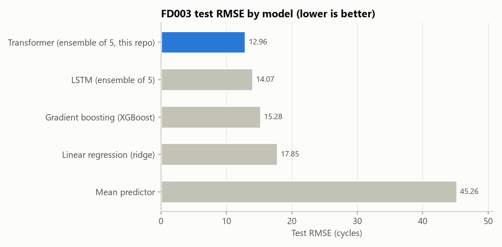
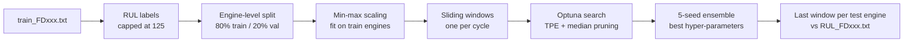

# Turbofan Engine RUL Prediction with Transformers

[](https://github.com/SaadKhan1998/Turbofan-Engine-RUL-Prediction/actions/workflows/ci.yml)


Predicts the **Remaining Useful Life (RUL)** of aircraft turbofan engines from multivariate
sensor histories in the NASA **C-MAPSS** dataset (FD001 and FD003). This is a predictive-maintenance
task: given the sensor readings an engine has produced so far, estimate how many more operating
cycles it can run before it fails.

The model is a Transformer encoder trained in PyTorch. Optuna tunes its hyper-parameters, and the
final model averages a five-seed ensemble. The whole pipeline (download, preprocessing, tuning,
training, evaluation and standalone inference) runs from the command line and is covered by unit
and end-to-end tests.

## Results

Each of the 100 engines in the official test set gets one prediction, made from its last
recorded cycle and compared with NASA's ground truth (`RUL_FDxxx.txt`). Lower is better on every
metric.

| dataset | test RMSE | test MAE | NASA score | RMSE vs. truth capped at 125* |
|---|---|---|---|---|
| **FD001** (1 condition, 1 fault mode) | **14.33** | 10.66 | 315.2 | 13.20 |
| **FD003** (1 condition, 2 fault modes) | **12.96** | 9.26 | 283.6 | 11.39 |

\* Many papers cap the ground truth at the same 125 cycles used for training. That column is
shown so the numbers can be compared with that literature.

* The five-seed ensemble beats every individual member on both datasets. Single members score
  14.35-15.91 RMSE on FD001 and 13.17-14.01 on FD003.
* An RMSE of 14 means the predicted remaining life is typically about 10-14 cycles off. Accuracy
  is highest near the end of life. For test engines with fewer than 40 cycles left, the mean
  absolute error is 3.2 cycles on FD001 (28 engines) and 2.3 on FD003 (22 engines). That is the
  region that matters for scheduling maintenance.
* Optuna ran 40 trials per dataset on an RTX 5060 Laptop GPU, taking about 37 minutes per dataset
  including the final ensemble. Both searches chose 50-cycle windows and a single encoder layer.
  All chosen settings are recorded in `outputs/<dataset>/training_config.json`.

To reproduce:

```bash
python train.py --dataset FD001 --epochs 100 --patience 15 --trials 40 --ensemble 5 --output_dir outputs/FD001
python train.py --dataset FD003 --epochs 100 --patience 15 --trials 40 --ensemble 5 --output_dir outputs/FD003
```

<p align="center">
  
  
</p>

Predicted RUL over the observed life of four FD001 test engines. The blue line is the capped
ground truth; the model has to work out from the sensors alone when degradation begins:



Figures for FD003, and the training and validation curves, are in [`outputs/FD003`](outputs/FD003)
and [`outputs/FD001`](outputs/FD001).

### Baseline comparison

Is the Transformer worth its complexity? `baselines.py` trains simpler models on **exactly the same**
engines, split, scaling, 50-cycle windows and test engines. Each baseline is tuned on the
validation engines only.

| model | FD001 test RMSE | FD003 test RMSE | FD001 NASA | FD003 NASA |
|---|---|---|---|---|
| **Transformer, 5-seed ensemble (this repo)** | **14.33** | **12.96** | **315** | **284** |
| Gradient boosting (XGBoost, 300 trees) | 14.81 | 15.28 | 332 | 412 |
| LSTM, 5-seed ensemble | 14.88 | 14.07 | 352 | 301 |
| Linear regression (ridge) | 16.23 | 17.85 | 408 | 585 |
| Mean predictor (no learning) | 43.24 | 45.26 | 35,723 | 60,716 |

<p align="center">
  
  
</p>

What this shows:
* **The Transformer has the lowest error on both datasets**, but the margin over the next-best
  model is modest: 0.5 RMSE on FD001 and 1.1 on FD003.
* **Sequence models matter more on FD003.** FD003 has two failure modes. There, both sequence
  models (Transformer, LSTM) clearly beat the models that see the window as a flat list of
  numbers (XGBoost, linear). On the single-fault-mode FD001, XGBoost comes close.
* **All learned models are far better than guessing.** The average remaining life alone gives an
  RMSE of about 44.

Caveats, stated plainly:
* Differences under about 1 RMSE are within run-to-run noise. Rebuilding the LSTM (a change that
  computes the same thing but draws different random starting weights) moved its test RMSE by up
  to 0.9.
* The Transformer had a larger tuning budget: 40 Optuna trials, versus 15 for the LSTM and small
  grids for XGBoost and ridge regression.

```bash
python baselines.py --transformer_dir outputs/FD001     # ~10 min on an RTX 5060 Laptop GPU
python baselines.py --transformer_dir outputs/FD003
```

Results go to `outputs/<dataset>/baselines/`: `baseline_results.csv` and `.json`,
`baseline_test_predictions.csv` (every model's prediction for every test engine) and
`baseline_comparison.png`.

## How it works



**Data**
* The 26 C-MAPSS columns are `engine_id`, `cycle`, `op_setting_1-3` and `sensor_1-21`.
* The training target at each cycle is `last cycle - current cycle`, capped at 125. This is the
  standard piecewise-linear target: early in life, degradation can't yet be seen in the sensors.
* 20% of the training **engines** are held out for validation, so no engine's data leaks across
  the split.
* Inputs are the sensors that vary on the training engines (15 for FD001, 16 for FD003). The operating settings
  are excluded by default because FD001 and FD003 run at a single operating condition.
* `MinMaxScaler` is fit on the training engines only.
* There is one window per cycle, labelled with the RUL at the window's last cycle. Windows that
  would start before cycle 1 are front-padded by repeating the first reading. This is exactly how
  short test engines are padded at inference time, so the model is trained on the same kind of
  input it is tested on.

**Model** (`rul/model.py`)

`[batch, seq_len, n_features]` -> linear projection to `d_model` -> sinusoidal positional encoding ->
Transformer encoder -> mean pooling over time -> MLP head -> **one RUL value per sequence**.

**Training** (`rul/engine.py`)
* AdamW with a linear warm-up followed by cosine learning-rate decay, plus gradient clipping.
* MSE loss on targets scaled to [0, 1]; Huber loss is available with `--loss huber`.
* Validation loss, RMSE and MAE are computed every epoch. Training stops early when validation
  loss stops improving, and only the weights from the lowest-validation-loss epoch are kept.
* Seeds are set for Python, NumPy, PyTorch and CUDA.
* The training windows are copied to the GPU once, and mini-batches are sliced there directly.

**Hyper-parameter search**

Optuna's TPE sampler with median pruning searches:
* learning rate
* batch size
* window length (30, 40 or 50 cycles)
* `d_model`
* number of encoder layers
* dropout
* weight decay

Each trial is scored on validation loss only; the test set is never used for any choice. The best
configuration is then retrained with five seeds and their predictions are averaged.

**Evaluation**

Each of the 100 test engines gets one prediction, made from the window that ends at its final
recorded cycle, and is compared with `RUL_FDxxx.txt`. Metrics are RMSE, MAE and the asymmetric
NASA/PHM08 score, which penalises late predictions (over-estimating remaining life) more heavily
than early ones.

## Quick start

```bash
git clone https://github.com/SaadKhan1998/Turbofan-Engine-RUL-Prediction.git
cd Turbofan-Engine-RUL-Prediction
python -m venv .venv
.venv\Scripts\activate                      # Linux/macOS: source .venv/bin/activate
pip install -r requirements.txt             # CUDA GPU: first `pip install torch --index-url https://download.pytorch.org/whl/cu128`
python download_data.py --dataset_dir data/CMAPSS
```

### Train

```bash
python train.py --dataset_dir data/CMAPSS --dataset FD001 --epochs 50 --trials 10
```

If the dataset files are missing, `train.py` exits with a message explaining how to get them (or
pass `--download`).

| argument | default | description |
|---|---|---|
| `--dataset` | `FD001` | `FD001` or `FD003` |
| `--dataset_dir` | `data/CMAPSS` | folder with `train_/test_/RUL_FDxxx.txt` |
| `--seq_len` | 30 | window length in cycles |
| `--batch_size` | 64 | mini-batch size |
| `--lr` | 1e-3 | learning rate |
| `--epochs` | 50 | max epochs per model (early stopping applies) |
| `--trials` | 10 | Optuna trials; `0` trains directly with the values given |
| `--output_dir` | `outputs/<dataset>_<time>` | where artifacts are written |
| `--seed` | 42 | random seed |
| `--search` | `full` | `basic` = learning rate + batch size only |
| `--ensemble` | 5 | number of seeds averaged in the final model |
| `--patience` | 10 | early-stopping patience |
| `--rul_clip` | 125 | RUL cap; `0` disables it |
| `--loss` | `mse` | `mse` or `huber` |
| `--pooling` | `mean` | `mean` over time or the `last` step |

`--seq_len`, `--batch_size` and `--lr` (and the model-size flags) are used directly when
`--trials 0`. Otherwise they become the first Optuna trial. Run `python train.py --help` for all
options.

**Artifacts** written to `--output_dir`:

| file | contents |
|---|---|
| `best_model.pt` | ensemble weights, model config, feature list, `seq_len`, RUL cap |
| `scaler.joblib` | fitted `MinMaxScaler` |
| `training_config.json` | every argument, chosen hyper-parameters, engine split, all Optuna trials |
| `train_history.csv` | per-epoch losses, RMSE, MAE and learning rate for every ensemble member |
| `test_predictions.csv` | one row per test engine: true RUL, prediction, error, ensemble spread |
| `metrics.json` | test and validation RMSE, MAE and NASA score |
| `training_loss.png`, `validation_loss.png` | loss curves |
| `test_pred_vs_true.png`, `test_engines_sorted.png`, `rul_trajectories.png` | evaluation figures |
| `optuna_trials.csv`, `best_params.json` | search results |

### Predict with a saved model

```bash
python predict.py --model outputs/FD001/best_model.pt --scaler outputs/FD001/scaler.joblib \
    --test_file data/CMAPSS/test_FD001.txt --rul_file data/CMAPSS/RUL_FD001.txt --output predictions.csv
```

`predict.py` rebuilds exactly the same scaled, padded windows used in training (both scripts share
`rul/data.py`) and writes one prediction per engine. `--rul_file` is optional; when given, it adds
error columns and prints metrics. On a CUDA GPU the output matches `test_predictions.csv` exactly;
on a CPU it matches to within about 0.05 cycles, because of floating-point precision.

## Project structure

```
|-- train.py              # end-to-end training pipeline (CLI)
|-- predict.py            # standalone engine-level inference (CLI)
|-- baselines.py          # mean / ridge / XGBoost / LSTM comparison on identical data (CLI)
|-- download_data.py      # fetches the C-MAPSS text files
|-- rul/
|   |-- data.py           # loading, labels, engine split, scaling, windowing
|   |-- model.py          # RULTransformer, LSTM baseline, ensemble, checkpoint save/load
|   |-- engine.py         # training loop, early stopping, metrics
|   `-- plots.py          # figures
|-- tests/                # unit + end-to-end tests on synthetic C-MAPSS-format data
|-- outputs/FD001, FD003  # reference runs (models, metrics, figures)
|-- .github/workflows/    # CI: ruff + pytest
|-- requirements.txt, requirements-dev.txt, pyproject.toml
```

## Development

```bash
pip install -r requirements-dev.txt
ruff check .
pytest
```

The tests check:
* the 26-column parsing
* the RUL labels and the cap
* that the engine split doesn't leak
* that windows never cross engine boundaries and that padding matches inference
* that test predictions map to the right engine IDs
* the model's output shape and order sensitivity
* that the LSTM baseline matches PyTorch's built-in multi-layer LSTM
* checkpoint round-trips
* the NASA score
* a full `train.py` -> `predict.py` -> `baselines.py` run

## Dataset

A. Saxena, K. Goebel, D. Simon and N. Eklund, *"Damage Propagation Modeling for Aircraft Engine
Run-to-Failure Simulation"*, PHM 2008. The data is distributed by the
[NASA Prognostics Center of Excellence](https://www.nasa.gov/intelligent-systems-division/discovery-and-systems-health/pcoe/pcoe-data-set-repository/).
The data files are not included in this repository.

## License

[MIT](LICENSE)
